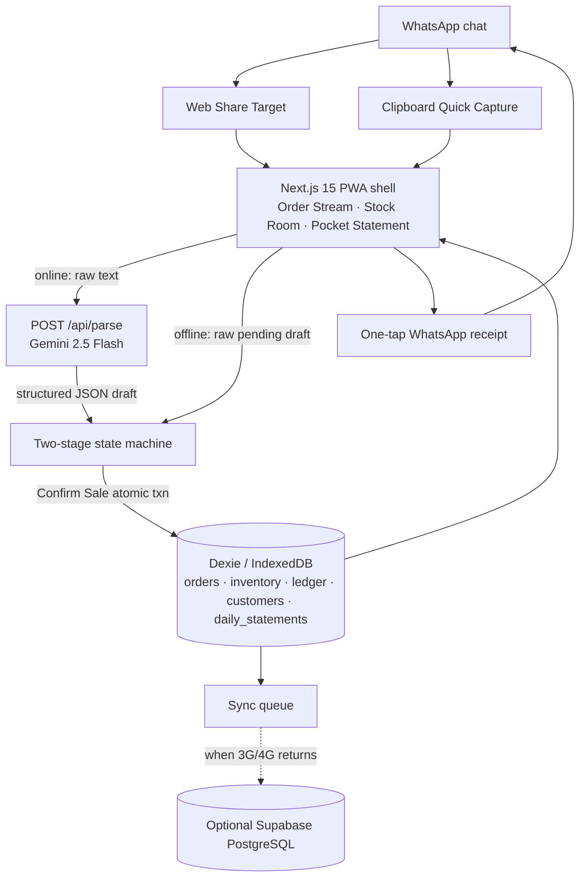

# BridgeWise

**Smarter Business. Better Growth.** BridgeWise is an offline-first Progressive Web App that sits beside WhatsApp on a Nigerian vendor’s phone and turns messy chat into orders, stock, and a three-number pocket statement in Naira.

There is no application source in this repository yet. This README is the project context document. Implementers should follow [`phrases.md`](./phrases.md) for the phase-by-phase build plan.

---

## Problem and research

Field interviews with **N = 12** social-commerce vendors grounded the product:

| Pain | Share of vendors |
| :--- | :--- |
| Financial tracking / cash commingling | **66.7%** |
| Inventory visibility | **50%** |
| Operate primarily on WhatsApp | **75%** |

About **60%** of inbound WhatsApp messages are window shopping: price checks, “keep one for me,” and other tentative talk that never becomes payment. If the app deducted stock or booked revenue at parse time, the Stock Room and Pocket Statement would lie.

WhatsApp itself is only a messaging layer. It does not deduct units, protect restock capital, or separate “money I can spend” from “money I must put back into goods.” BridgeWise is the operational back-office for that gap—without an App Store download, a WhatsApp Business API approval, or a forced login.

---

## Who it is for

Solo and small-team **WhatsApp social vendors** in Nigeria: kitchens, workshops, fashion stalls, cake bakers, shoe and bag sellers, Ankara traders. They take orders in chat (often Pidgin and slang), move between supplier, kitchen, and rider, and run on mid-range Android phones with flaky 3G/4G.

They need one-handed mobile screens, Naira amounts, and a tool that still works when the network drops.

---

## What it is / is not

**It is**

- A lightweight, **offline-first** operational PWA beside WhatsApp, not a replacement for WhatsApp.
- A **three-tab workspace** (Order Stream, Stock Room, Pocket Statement) plus capture (Share Target + clipboard) and one-tap WhatsApp receipts.
- A **two-stage** engine: parse creates a pending inquiry; only vendor **Confirm Sale** mutates stock and the ledger.
- **Local-first.** IndexedDB is the system of record on the device. Cloud backup is optional and later.

**It is not (MVP)**

- WhatsApp Business API, catalogs, or official WhatsApp webhooks.
- A payment processor, bank transfer confirmation service, or POS.
- Maps, rider dispatch, or delivery routing.
- An admin portal, multi-tenant dashboard, or forced vendor accounts.
- A full voice-note product. Voice notes appear in the architecture as a future input; **MVP is text-first**.
- A product for Opera Mini as a primary target. Research names Opera Mini; it is a poor PWA host. **Chrome and Safari** are primary.

---

## Core loop

Window shoppers never touch stock or cash. The loop is:

1. **WhatsApp** — customer messages the vendor (e.g. “Pls send 2 black bags to Lekki Phase 1”).
2. **Capture** — vendor Shares the bubbles to BridgeWise, or copies text and uses Quick Capture / clipboard.
3. **Pending** — Gemini parses into a structured draft. Status is `PENDING_INQUIRY`, `ledger_committed = false`. Zero units deducted, ₦0 on the Pocket Statement.
4. **Confirm** — after payment or dispatch, the vendor taps **Confirm Sale**.
5. **Stock + ledger** — one atomic Dexie transaction deducts SKUs, writes a `SALE` ledger entry, splits restock capital vs profit, and refreshes the daily statement.
6. **Receipt + pocket** — vendor shares a formatted receipt back into WhatsApp; Pocket Statement shows Total Sales, Protected Restock Capital, and Safe Net Profit.

If the phone is offline at capture time, raw text is stored as a `PENDING_INQUIRY` draft so the vendor can still confirm or edit without waiting for the parser.

---

## Product surfaces

| Surface | Role |
| :--- | :--- |
| **Order Stream** | Operational inbox. Amber cards = pending inquiries. Green cards = confirmed sales. Confirm, cancel/expire, return, and one-tap WhatsApp receipt live here. |
| **Stock Room** | Live SKU list: quantity, unit cost, selling price, Green / Yellow / Red health. Sales never edit counts by hand; restock logs increment stock and record cost. |
| **Pocket Statement** | Daily three-bucket ledger in Naira (see finance rules below). |
| **Quick Capture** | Floating / in-viewport trigger that reads the clipboard (`navigator.clipboard.readText()`). |
| **Share Target** | `/share-target` route registered in `manifest.json` so BridgeWise appears in the Android/iOS Share Sheet from WhatsApp. |

A top status bar shows offline vs queued vs synced. Bottom nav switches the three tabs. The shell is a single mobile viewport, not a desktop CRM.

---

## Simplified architecture



| Layer | Choice | Why |
| :--- | :--- | :--- |
| Core framework | **Next.js 15 App Router** | One React UI plus Route Handlers for parse (and later sync). No separate backend process. |
| Language | **TypeScript** | Order states, stock thresholds, and financial splits are type-checked. |
| UI | **Tailwind CSS + Lucide** | Mobile-first layout, high-contrast badges, small icon set. |
| PWA | **Serwist** via `@ducanh2912/next-pwa` | App-shell cache, `manifest.json`, Web Share Target. HTTPS required (Service Worker + Clipboard). |
| Local DB | **Dexie.js** on IndexedDB | ACID `db.transaction('rw', …)` for confirm / return. |
| AI | **Google Gemini `gemini-2.5-flash`** behind `/api/parse` | Structured JSON from WhatsApp text and short expense strings. API key never ships to the client. |
| Cloud (optional) | **Supabase (PostgreSQL)** | Background backup and multi-device recovery when connectivity exists. Not required to use the app. |
| Hosting | **Vercel** | Edge HTTPS, which browsers require for PWA APIs. |

Primary browsers: **Chrome (Android)** and **Safari (iOS)**. Add to Home Screen is the install path.

---

## Domain model and deterministic IDs

All operational records live in IndexedDB first. IDs are human-readable composite keys so a vendor (or an auditor) can search without inventing filenames.

| Store | ID rule | Example | Core fields |
| :--- | :--- | :--- | :--- |
| `orders` | `[Customer]_[YYYY-MM-DD]_[Seq]` | `Chioma_2026-11-12_Ord004` | `order_id`, customer, `items[]`, delivery, `status`, `ledger_committed` |
| `inventory` | `[Product_Slug]_[Variant]` | `Black_Shoes_Size42` | `sku_id`, display name, `stock_qty`, `low_stock_threshold`, unit cost/sell, `status_color` |
| `ledger_entries` | `TXN_[YYYY-MM-DD]_[Type]_[Seq]` | `TXN_2026-11-12_SALE_009` | `txn_id`, `ref_order_id`, `SALE` / `EXPENSE` / `RESTOCK`, amounts, capital vs profit |
| `daily_statements` | `Daily_Summary_[YYYY-MM-DD]` | `Daily_Summary_2026-11-12` | totals for sales, expenses, protected capital, net profit |
| `customers` | `CUST_[Phone_or_NameHash]` | `CUST_Chioma_Nwosu` | name, saved addresses, preferences |

**Order ID rule:** IndexedDB primary keys always use `[Customer]_[YYYY-MM-DD]_[Seq]`. The AI parser may emit a sample payload id such as `ORD-20261112-004`. That value is **payload-only**; it is not the stored order key.

**SKU ID rule:** `[Product_Slug]_[Variant]` (e.g. `Blue_Handbag_Std`). Parser product codes such as `PROD-BAG-BLUE` are hints to match, not the inventory primary key.

---

## State machine and atomic commit rules

### Stored order states

Only these four values are persisted:

| State | Trigger | Inventory | Ledger |
| :--- | :--- | :--- | :--- |
| `PENDING_INQUIRY` | Share / paste / offline draft | None | ₦0; excluded from Pocket Statement |
| `CONFIRMED_SALE` | Vendor taps **Confirm Sale** | Atomic deduction | Atomic split: revenue → protected capital + net profit |
| `CANCELLED` / `EXPIRED` | Ghost lead, archive, or timeout | None (nothing was deducted) | None; no reversing entries |
| `REFUNDED` / `RETURNED` | Vendor processes a return on a confirmed sale | Restore quantity | Reverse the sale on that day’s statement |

`READY_TO_CONFIRM` is an **AI suggestion only** (payment/commitment language such as “transfer sent”). The UI may highlight a Confirm button. It is not a stored status. Until the vendor taps Confirm, the row stays `PENDING_INQUIRY`.

The parser may also set `intent_classification` / `suggested_status` from inquiry vs commitment phrasing. Suggestions never write stock or money.

### Atomic commit (Confirm Sale)

One Dexie read-write transaction covers `orders`, `inventory`, `ledger_entries`, and `daily_statements`:

1. Load the order. If missing or `ledger_committed === true`, **no-op** (idempotent; no double deduction).
2. For each line, load the SKU. If `stock_qty` would go below zero, **abort the whole transaction**. Do not clamp with `Math.max(0, …)`. Oversell is not allowed.
3. Deduct quantities, recompute Green / Yellow / Red, write inventory.
4. Insert one `SALE` ledger row: gross, capital portion (sum of unit cost × qty), net profit portion.
5. Set `status = CONFIRMED_SALE`, `ledger_committed = true`.
6. Recalculate `Daily_Summary_[date]`.

Parse, clipboard ingest, and Share Target **must not** run steps 2–6. Ignore Blueprint workflow steps 03–04 (deduct and split immediately after NLP). Those steps conflict with the capture/state addendum and the full system spec; **ledger commit is vendor Confirm only**.

Returns run a matching reverse transaction (restore stock, reverse ledger). Cancels of pending inquiries write no inventory or money.

The architecture notes auto-archive of unconfirmed leads after **72 hours**; treat that as a candidate for `EXPIRED`, not a fifth stored status.

---

## Capture and identity

Mobile OS sandboxing means BridgeWise cannot read WhatsApp’s private store. Capture is explicit and privacy-safe:

1. **Web Share Target** — vendor highlights one or more bubbles, Share → BridgeWise. Multi-bubble shares often include display name, timestamp, and text, e.g. `[11/12, 10:15 AM] Amaka: Pls send 2 black bags to Lekki`.
2. **Clipboard** — vendor copies in WhatsApp, opens BridgeWise, taps Quick Capture; `navigator.clipboard.readText()` feeds `/api/parse` (or a pending draft if offline).

A true always-on overlay bubble is not available in a pure browser PWA. The in-app trigger is the MVP. A Trusted Web Activity wrapper with overlay permission is optional later, not required to ship.

### Three-tier customer names

| Priority | Source | Result |
| :--- | :--- | :--- |
| **Tier 1** | WhatsApp multi-bubble header | e.g. `Chioma Nwosu`, matched to `customers` if seen before |
| **Tier 2** | In-text self-identification | e.g. “this is Tunde from Ikeja” → name + delivery zone |
| **Tier 3** | Fallback | `Walk-in / Inquiry #014` plus a one-tap contact picker so capture never blocks |

Vendors should not have to type the customer name as the happy path.

Expense and restock strings (e.g. “Fuel 5k, nylon 3k”, “Restocked 20 Ankara @ ₦40k”) use the same parse route with different schemas. They are not sales.

---

## Inventory badges and finance rules

### Stock health

| Badge | Trigger | Behaviour |
| :--- | :--- | :--- |
| **GREEN · SAFE** | `stock_qty > low_stock_threshold` (default: more than 4 units, or more than 20% of last restock batch) | Confirm allowed |
| **YELLOW · LOW** | `0 < stock_qty ≤ low_stock_threshold` | Warning / pin; suggest restock from recent velocity |
| **RED · OUT OF STOCK** | `stock_qty === 0` | **Alert and block Confirm Sale for that SKU.** The vendor cannot confirm a line they cannot fulfil. |

RED is not a soft warning. The PDF’s “alert before confirm” is tightened to **block**. Restock logging is how a red SKU becomes orderable again.

Vendors do not type new counts during a sale. Counts change only from confirmed sales, returns, and restock logs.

### Pocket Statement (UI)

The daily statement is three numbers, not a spreadsheet:

1. **Total Sales** — gross inflow from `ledger_committed` sales that day.
2. **Protected Restock Capital (Do Not Spend)** — sum of unit cost prices for those sold units; the money that must buy the next batch.
3. **Safe Net Profit (Yours)** — sales minus restock capital minus operational expenses.

Expenses (fuel, nylon, delivery) are tracked internally as `EXPENSE` ledger rows. The UI does **not** make “Total Expenses” a fourth headline bucket. Expenses appear as the deduction on profit (as in the spec example: Safe Net Profit after ₦3k fuel).

All amounts are **Naira**. Capital vs profit exists specifically to stop commingling household cash with restock money.

---

## Company vs product

| | **Bridgewise** (company) | **BridgeWise** (this product) |
| :--- | :--- | :--- |
| Name | Bridgewise | BridgeWise |
| Tagline | Smarter Business. Better Growth. | Same tagline on the product |
| What it is | Emerging African software company; SaaS first, later hybrid (products + custom automation) | First shipped product: the WhatsApp-vendor PWA described here |
| Mission / vision | Accessible tech and intelligent automation for African businesses; operate smarter, grow sustainably | Concrete instance: WhatsApp capture, stock, pocket statement |
| Values | Innovation, simplicity, customer-first, integrity, collaboration, continuous improvement | Applied as local-first, no forced accounts, three plain numbers |

The company foundation note left “initial product TBD” pending research. **Research selected this PWA.** Product architecture overrides that placeholder. This repo is the product; company identity still lives in the foundation document.

The foundation file is a working identity note, not incorporation papers or a founders’ agreement.

---

## Source documents map

Original product specs live in [`docs/`](./docs/). Read them before changing behaviour. Where they disagree, this README’s **canonical decisions** win.

| Document | Use it for |
| :--- | :--- |
| [`bridgewise_tech_stack_architecture_documentation.md`](./docs/bridgewise_tech_stack_architecture_documentation.md) | Stack, folder sketch, Dexie stores, `/api/parse`, env vars, Serwist/PWA |
| [`BridgeWise_Full_System_And_UI_Architecture.pdf`](./docs/BridgeWise_Full_System_And_UI_Architecture.pdf) | Three-layer system, three-tab UI, ID tables, badge math, atomic confirm sketch |
| [`BridgeWise_PWA_Architecture_Blueprint.docx`](./docs/BridgeWise_PWA_Architecture_Blueprint.docx) | Research stats, PWA rationale, modules, receipts — **not** steps 03–04 (early stock/ledger) |
| [`BridgeWise_Capture_And_State_Architecture.docx`](./docs/BridgeWise_Capture_And_State_Architecture.docx) | Share vs clipboard, 3-tier names, four stored states, window-shopper rule |
| [`Bridgewise_Company_Foundation_Phase_1(1).docx`](./docs/Bridgewise_Company_Foundation_Phase_1(1).docx) | Company name, tagline, mission, values, growth stages |
| [`phrases.md`](./phrases.md) | Phase-by-phase implementation plan |

**Resolved conflicts (do not re-litigate in code):**

- Product name **BridgeWise**; company **Bridgewise**.
- First product **is** this PWA.
- Stock and ledger move **only** on Confirm Sale (`ledger_committed`).
- IndexedDB order IDs are `[Customer]_[YYYY-MM-DD]_[Seq]`; `ORD-…` is AI payload only.
- SKU IDs are `[Product_Slug]_[Variant]`.
- Stored states are the four in the table above; `READY_TO_CONFIRM` is suggestion-only.
- Pocket UI is the three buckets; expenses deduct from profit, not a fourth headline.
- RED stock **blocks** confirm for qty 0.
- Auth is local-first; Supabase is optional later.
- No WhatsApp Business API, payments, maps, or admin portal in MVP.
- Voice is mentioned; ship text first.
- Primary browsers: Chrome and Safari, not Opera Mini.

---

## Open gaps / decisions still needed

These are honestly unresolved. Do not pretend the specs closed them.

- **SKU onboarding.** Products need cost, sell price, variant, and threshold before confirm can be atomic. The docs say “configured once” but do not specify first-run catalog UX, barcode, or parse-time SKU creation vs strict match.
- **Privacy and NDPR.** Capture of chat text, names, and addresses on-device (and later in Supabase) needs a retention, consent, and Nigeria Data Protection Regulation story. Not specified.
- **Sync conflicts.** Optional multi-device Supabase sync has no last-write, merge, or split-brain rule if two phones confirm the last unit.
- **Identity without accounts.** Local-first is decided; how a later backup login maps to an existing IndexedDB without duplicating orders is not.
- **Gemini cost, quota, and failure.** Offline draft is specified; online parse errors, retries, and PII sent to Google are not.
- **72-hour expiry.** PDF auto-archives unconfirmed leads; the state addendum uses vendor Cancel. Exact timer UX is open.
- **TWA vs browser PWA.** Floating bubble “over WhatsApp” implies Android TWA; MVP is in-app capture.
- **Receipt copy.** One-tap share is specified; exact Naira template, branding, and whether receipts include cost/profit (they should not) is not locked.
- **Low-stock default.** “> 4 units or > 20% of batch” needs a single default when batch size is unknown.
- **Customer ID.** `CUST_[Phone_or_NameHash]` does not define phone capture without the Business API.
- **iOS Share Target and clipboard permissions.** Android is the happy path; iOS support will be thinner and needs explicit testing.
- **Legal / commercial.** Foundation is not incorporation; pricing, subscription, and terms for the SaaS motion are out of scope here.

---

## How to use this repo

Product specs live in [`docs/`](./docs/). The Next.js 15 app lives in [`bridgewise-pwa/`](./bridgewise-pwa/). Node version (`.nvmrc`) and env template (`.env.example`) live **inside the app**, not at the repo root. There is a single `.gitignore` at the repo root.

```bash
cd bridgewise-pwa
source ~/.nvm/nvm.sh && nvm use   # Node 22 from .nvmrc
cp .env.example .env.local        # already created; keep keys out of git
npm run dev
```

1. Read this README for canonical product rules.
2. Read the source documents in the map above when you need depth.
3. Build in the order given in **[`phrases.md`](./phrases.md)**.

### Deploy on Vercel (HTTPS)

Public HTTPS is required for the service worker, Add to Home Screen, Share Target, and clipboard on a real phone. The Next.js app is the **`bridgewise-pwa`** subfolder, not the repo root.

1. Import the Git repository at [vercel.com/new](https://vercel.com/new). Framework: **Next.js**.
2. Set **Root Directory** to `bridgewise-pwa`.
3. Environment Variables (Production and Preview): `GEMINI_API_KEY` only, server-side. Do **not** prefix `NEXT_PUBLIC_`. Do **not** add Stripe, maps, WhatsApp Business, or `NEXT_PUBLIC_SUPABASE_*` keys. Do not paste the real key into this README.
4. Deploy, then on Android Chrome open the `https://…` URL → **Add to Home Screen** → share a WhatsApp chat into BridgeWise.

Local production gate (Node 22, inside `bridgewise-pwa`): `npx tsc --noEmit && npm test && npm run build`.

Nigeria, Naira, and WhatsApp social commerce are the default context for every screen and ID example. Window shoppers stay pending until the vendor confirms.
